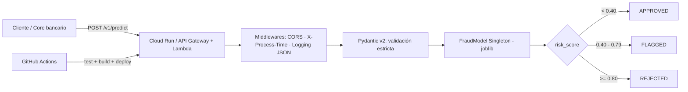

# 🛡️ Fraud Detection Cloud AI


[](https://github.com/OWNER/fraud-detection-cloud-ai/actions/workflows/test.yml)

> Replace `OWNER` in the CI badge with your GitHub user / organization.

**🇪🇸 [Español](#-español) · 🇬🇧 [English](#-english)**

---

# 🇪🇸 Español

API serverless de **detección de fraude transaccional en tiempo real** con FastAPI y un modelo `RandomForestClassifier`. Se despliega como contenedor en **Google Cloud Run** o como imagen en **AWS Lambda** (vía Mangum).

## Arquitectura



```text
Cliente ──► [CORS] ─► [X-Process-Time + JSON logs] ─► FastAPI ─► Pydantic (strict)
                                                         │
                                          FraudModel (Singleton, thread-safe)
                                                         │
                                     risk_score ─► APPROVED | FLAGGED | REJECTED
```

## Estructura

| Ruta | Descripción |
|---|---|
| `src/app.py` | FastAPI, middlewares, rutas y `handler = Mangum(app)` |
| `src/config.py` | Configuración por variables de entorno (Pydantic Settings) |
| `src/schemas.py` | DTOs: `TransactionRequest`, `TransactionResponse`, `HealthCheckResponse` |
| `src/model.py` | `FraudModel` (Singleton thread-safe) + inferencia |
| `src/utils.py` | Logging JSON estructurado y regla de decisión |
| `data/generate_dataset.py` | Dataset sintético (6 000 filas, 8 % fraude por defecto) |
| `train.py` | Entrenamiento 80/20, métricas y serialización a `src/model.joblib` |
| `tests/` | Pytest: endpoints, modelo; `conftest.py` entrena un modelo mínimo para los tests |
| `Dockerfile` / `Dockerfile.aws` | Imágenes multi-stage (Cloud Run / Lambda); entrenan el modelo durante el build |

## Puesta en marcha local

```bash
git clone https://github.com/OWNER/fraud-detection-cloud-ai.git
cd fraud-detection-cloud-ai

make install        # crea .venv e instala dependencias
make train          # genera datos sintéticos, entrena y guarda src/model.joblib
make test           # pruebas + cobertura
make run            # API en http://localhost:8080  (docs: /docs)
```

Sin `make`:

```bash
python3 -m venv .venv && source .venv/bin/activate
pip install -r requirements-dev.txt
python train.py
uvicorn src.app:app --port 8080 --reload
```

Con los parámetros por defecto el modelo obtiene en el hold-out (dataset sintético): Precision ≈ 0.95, Recall ≈ 0.94, F1 ≈ 0.94, ROC-AUC ≈ 0.998. Son datos sintéticos: **no** representan el desempeño con datos reales.

## Variables de entorno

| Variable | Defecto | Descripción |
|---|---|---|
| `MODEL_PATH` | `src/model.joblib` | Ruta del modelo serializado |
| `RISK_THRESHOLD` | `0.80` | `score >=` → `REJECTED` (`is_fraud = true`) |
| `FLAG_THRESHOLD` | `0.40` | `score >=` → `FLAGGED` (revisión manual) |
| `API_KEY` | *(vacío)* | Si se define, `/v1/predict` exige el header `X-API-Key` |
| `CORS_ORIGINS` | `*` | Orígenes permitidos separados por coma |
| `LOG_LEVEL` | `INFO` | Nivel de logging |

## API

| Método | Ruta | Respuestas |
|---|---|---|
| `GET` | `/` | `200` estado, versión y si el modelo está cargado |
| `POST` | `/v1/predict` | `200` decisión · `400` JSON mal formado · `401` API key inválida · `422` payload inválido · `500` error inesperado · `503` modelo no disponible |

Todas las respuestas incluyen `X-Process-Time` y `X-Request-ID`.

### Pruebas con cURL

```bash
# Healthcheck
curl -s http://localhost:8080/

# Transacción segura -> APPROVED
curl -s -X POST http://localhost:8080/v1/predict \
  -H "Content-Type: application/json" \
  -d '{"amount":25.5,"hour_of_day":14,"is_foreign_card":false,"failed_attempts_last_24h":0,"distance_from_home_km":2.0,"transaction_velocity_1h":1}'

# Transacción riesgosa -> REJECTED / FLAGGED
curl -s -X POST http://localhost:8080/v1/predict \
  -H "Content-Type: application/json" \
  -d '{"amount":4500,"hour_of_day":3,"is_foreign_card":true,"failed_attempts_last_24h":6,"distance_from_home_km":800,"transaction_velocity_1h":9}'

# Payload inválido -> 422
curl -s -X POST http://localhost:8080/v1/predict \
  -H "Content-Type: application/json" -d '{"amount":-5}'

# Con API key (si API_KEY está definida)
curl -s -X POST http://localhost:8080/v1/predict -H "X-API-Key: <tu-clave>" \
  -H "Content-Type: application/json" -d '{...}'
```

Ejemplo de respuesta:

```json
{
  "transaction_id": "7fae5ada-8dec-43de-ae1b-2d9eec28eb08",
  "risk_score": 1.0,
  "is_fraud": true,
  "status": "REJECTED",
  "timestamp": "2026-11-08T15:24:50.354256Z",
  "inference_params": {
    "model_type": "RandomForestClassifier",
    "model_version": "1.0.0",
    "risk_threshold": 0.8,
    "flag_threshold": 0.4
  }
}
```

## Despliegue

### Google Cloud Run (automático con GitHub Actions)

`.github/workflows/deploy.yml` ejecuta lint + tests y, si pasan, construye la imagen, la sube a Artifact Registry y la despliega en Cloud Run.

1. Habilita APIs y crea el repositorio de imágenes:
   ```bash
   gcloud services enable run.googleapis.com artifactregistry.googleapis.com iamcredentials.googleapis.com
   gcloud artifacts repositories create fraud-detection --repository-format=docker --location=us-central1
   ```
2. Crea una cuenta de servicio con los roles `roles/run.admin`, `roles/artifactregistry.writer` y `roles/iam.serviceAccountUser`, y configura **Workload Identity Federation** para tu repositorio de GitHub.
3. En GitHub → *Settings → Secrets and variables → Actions*:
   - Secrets: `GCP_PROJECT_ID`, `GCP_WORKLOAD_IDENTITY_PROVIDER`, `GCP_SERVICE_ACCOUNT`, `API_KEY`
   - Variables (opcionales): `GCP_REGION` (`us-central1`), `CLOUD_RUN_SERVICE` (`fraud-detection-api`), `GAR_REPOSITORY` (`fraud-detection`)
4. Haz push a `main`.

Despliegue manual:

```bash
gcloud run deploy fraud-detection-api --source . --region us-central1 \
  --allow-unauthenticated --port 8080 --memory 1Gi \
  --set-env-vars API_KEY=<tu-clave>
```

### AWS Lambda (contenedor en ECR)

```bash
export AWS_REGION=us-east-1
export ACCOUNT_ID=$(aws sts get-caller-identity --query Account --output text)
export REPO=fraud-detection-lambda

aws ecr create-repository --repository-name $REPO --region $AWS_REGION
aws ecr get-login-password --region $AWS_REGION | \
  docker login --username AWS --password-stdin $ACCOUNT_ID.dkr.ecr.$AWS_REGION.amazonaws.com

docker build --platform linux/amd64 -f Dockerfile.aws -t $REPO .
docker tag $REPO:latest $ACCOUNT_ID.dkr.ecr.$AWS_REGION.amazonaws.com/$REPO:latest
docker push $ACCOUNT_ID.dkr.ecr.$AWS_REGION.amazonaws.com/$REPO:latest

aws lambda create-function --function-name fraud-detection-api \
  --package-type Image \
  --code ImageUri=$ACCOUNT_ID.dkr.ecr.$AWS_REGION.amazonaws.com/$REPO:latest \
  --role arn:aws:iam::$ACCOUNT_ID:role/<rol-de-ejecucion-lambda> \
  --memory-size 1024 --timeout 30 \
  --environment "Variables={API_KEY=<tu-clave>}"

aws lambda create-function-url-config --function-name fraud-detection-api --auth-type NONE
```

El rol de ejecución necesita la política `AWSLambdaBasicExecutionRole`. El handler es `src.app.handler`. Para producción, coloca la función detrás de API Gateway con autenticación/WAF en lugar de una Function URL pública.

## Notas de producción

- El dataset es sintético: antes de operar con dinero real, reentrena con datos históricos etiquetados, calibra umbrales y monitorea *drift*.
- Los logs JSON (`severity`, `message`, `request_id`…) son compatibles con Cloud Logging y CloudWatch.
- El modelo se entrena durante el `docker build`, por lo que la imagen es autocontenida; también puedes hornear un `model.joblib` versionado propio.

---

# 🇬🇧 English

**Real-time transactional fraud detection** serverless API built with FastAPI and a `RandomForestClassifier`. Ships as a container for **Google Cloud Run** or as an image for **AWS Lambda** (via Mangum).

## Architecture

See the Mermaid / ASCII diagrams in the Spanish section: *Client → CORS → timing + JSON-logging middleware → FastAPI → strict Pydantic validation → thread-safe `FraudModel` singleton → decision (`APPROVED` / `FLAGGED` / `REJECTED`)*.

## Quick start

```bash
git clone https://github.com/OWNER/fraud-detection-cloud-ai.git
cd fraud-detection-cloud-ai

make install   # create .venv and install dependencies
make train     # generate synthetic data, train, save src/model.joblib
make test      # tests + coverage
make run       # API at http://localhost:8080 (docs at /docs)
```

Hold-out metrics on the synthetic dataset with default settings: Precision ≈ 0.95, Recall ≈ 0.94, F1 ≈ 0.94, ROC-AUC ≈ 0.998. These come from synthetic data and say nothing about real-world performance.

## Configuration

`MODEL_PATH`, `RISK_THRESHOLD` (0.80 → `REJECTED`), `FLAG_THRESHOLD` (0.40 → `FLAGGED`), `API_KEY` (enables the `X-API-Key` header check), `CORS_ORIGINS`, `LOG_LEVEL`.

## API

- `GET /` → `200` with status, version and `model_loaded`.
- `POST /v1/predict` → `200` decision, `400` malformed JSON, `401` bad API key, `422` invalid payload, `500` unexpected error, `503` model unavailable.

```bash
curl -s -X POST http://localhost:8080/v1/predict \
  -H "Content-Type: application/json" \
  -d '{"amount":4500,"hour_of_day":3,"is_foreign_card":true,"failed_attempts_last_24h":6,"distance_from_home_km":800,"transaction_velocity_1h":9}'
```

## Deployment

- **GCP Cloud Run:** push to `main` and `.github/workflows/deploy.yml` runs lint + tests, builds the image, pushes it to Artifact Registry and deploys. Set the secrets `GCP_PROJECT_ID`, `GCP_WORKLOAD_IDENTITY_PROVIDER`, `GCP_SERVICE_ACCOUNT`, `API_KEY` (and optional variables `GCP_REGION`, `CLOUD_RUN_SERVICE`, `GAR_REPOSITORY`). Manual alternative: `gcloud run deploy fraud-detection-api --source . --region us-central1 --port 8080`.
- **AWS Lambda:** build with `docker build --platform linux/amd64 -f Dockerfile.aws`, push to ECR, then `aws lambda create-function --package-type Image ...` (handler `src.app.handler`). Full commands are in the Spanish section above.

## Tests & quality

```bash
make test    # pytest + coverage (the test suite trains its own small model)
make lint    # ruff check + ruff format --check
```

## License

MIT
